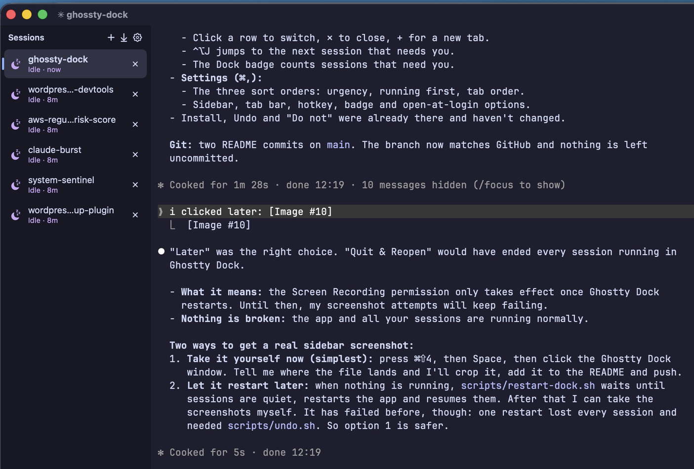
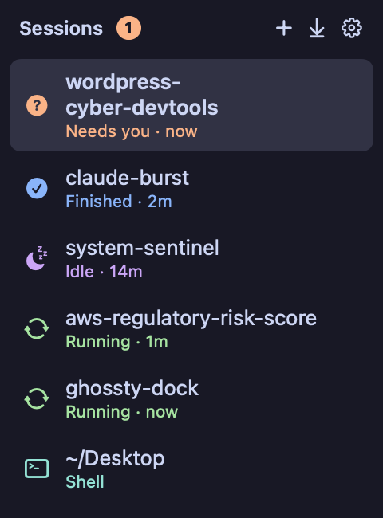
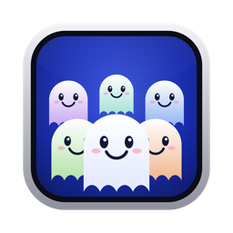
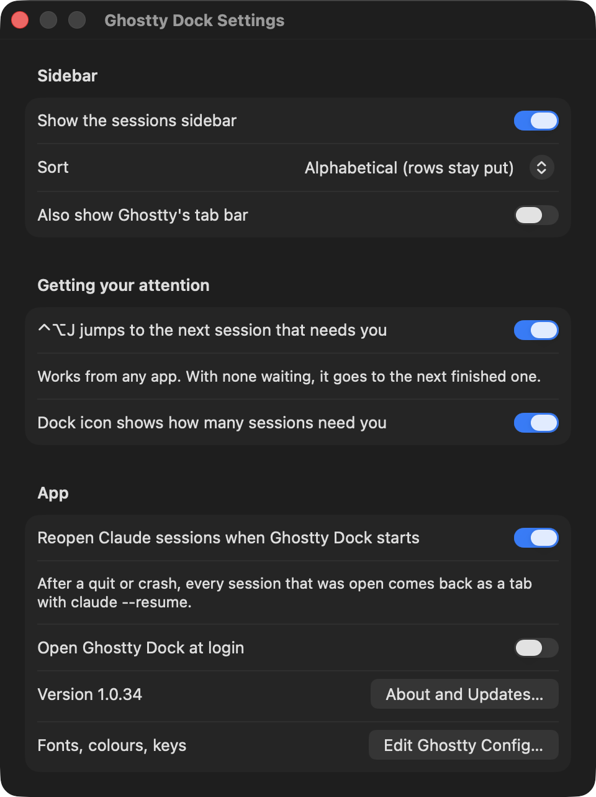

# Ghostty Dock

Ghostty with a Chrome-style vertical tab sidebar: one window, one Dock icon,
every Claude Code session as a tab, coloured by status (needs you, running,
finished, idle, shell) and sorted by name so rows stay put. Ctrl-Opt-J jumps to the
next session waiting for you.



 

It is Ghostty 1.3.1 plus `patches/ghostty-dock.patch`, built as
`~/Applications/Ghostty Dock.app`. A Claude Code hook (`bin/ghostty-dock-hook`)
reports each session's status.

## Sidebar

| Icon | Colour | Means |
|---|---|---|
| ? (pulsing) | peach | needs you: a question or permission prompt |
| ✓ | blue | finished, not looked at yet |
| moon | mauve | idle |
| spinning arrows | green | running |
| terminal | teal | plain shell, no Claude Code |

- Under "Sessions", a counter per state (needs you, running, finished, idle,
  shell, and undocked when there are any) shows how many tabs are in it.
- Click a row to switch to it; ✕ closes it; + opens a new tab.
- Each row shows its status, how long it has been in it, and **context size**
  (e.g. `168k ctx`: the tokens its last reply read, so you can see which
  sessions are near compaction).
- **Compact** (⤡, above Restart; or right-click → Compact (Pauseless)) types
  `/compact-async` into the session, so [Claude Burst](https://github.com/andrewbakercloudscale/claude-burst)'s
  Pauseless Compaction summarises it in the background and swaps the summary
  in with your next prompt. Only while the session is at its prompt (finished
  or idle), so it never answers a question or queues behind a running turn.
  Needs Claude Burst: without it the button offers to set it up (see below).
- **Restart** (↻, beside Undock; or right-click → Restart Session) stops claude
  and resumes the same session in a fresh tab at once. Same as
  `ghostty-dock-move --restart <session id>`.
- Drag the sidebar's right edge to make it wider or narrower (double-click the edge to reset).
- Click a row's **Undock** icon (↗, beside ✕; or right-click → Undock) to move that session out
  to its own Ghostty window: claude is stopped and resumed there at once.
- **Undocked**: Claude Code sessions in their own Ghostty windows are listed
  under the tabs, grey with a dashed outline. Click one to show its window, or
  its **Dock** icon (↙) to restart it in a tab here at once.
  Same as `ghostty-dock-move --pid <pid>`, `--undock <session id>`, `--detach`.
- Ctrl-Opt-J: jump to the next session that needs you (then finished ones).
- Dock badge: how many sessions need you.
- **What it's waiting on**: a row that needs you shows the question, or the
  tool call to allow ("Allow Bash: npm test"), so you know before you switch.
- **Cost**: each row ends with what the session has cost so far, subagents
  included, priced like the Cost Sidebar below. Off in Settings.
- **Branch, pull request and ports**: a line under each row like
  `main ↑2 ●3 · #42 · :3000` (commits not pushed, files changed, the open PR
  via `gh`, ports the session's processes listen on). Right-click to open
  the PR or the port. Off in Settings.
- **A glowing ring** around a row that needs you.
- **Notifications** when a session needs you or finishes, unless you are
  looking at it. Click one to go to its tab. Each can be turned off. The 🔔 in
  the header lists the last 200; going to a session marks its ones read.
- **Running sessions** have a gold glint running round their row.
- **Header buttons** each have their own colour; point at one and the
  counters line says what it does, so no tooltip covers a button.
- **Loading screen** at startup: a turning gold ring and "Loading…" with how many sessions are back, until they all are (Skip to dismiss).
- **Filter by state**: click a counter under the header (needs you, running,
  finished, idle, shell) to show only those sessions; click it again to show
  all.
- **Find (⌘P or the magnifier)**: type part of a name, folder or question;
  ↑↓ and Return. Closed sessions are in the list too.
- **Agents (⌘⇧A or the 👥 button)**: four tiles at the top (spending now,
  today, agents running, sessions that need you; click that one to go to
  it), then every subagent your sessions have started, one row each, grouped
  by session: what it is doing, type, model, tool calls, tokens, cost and how
  long ago. Busy sessions without agents show as "working on its own". Live,
  Today or All at the top right; point at a row for the token breakdown,
  click it to go to its session. (An agent is a helper a session starts with
  Claude Code's Agent tool: its own context, often in the background or its
  own worktree.) The **?** explains how to prompt for them (say subagents,
  parallel, background or worktree) and how to make your own (/agents or
  .claude/agents/*.md).
  **Set Up** lists every agent Claude Code can start (yours in
  ~/.claude/agents, each open project's .claude/agents, the plugins' and the
  built-in ones) with how often each ran, and lets you change yours: the
  description Claude chooses by, model, colour, tools, tools it may not use
  and its instructions. New agent (+), Duplicate as Mine (to customise a
  plugin's), Open in Editor, Move to Trash.
  A **Spend** line shows how fast money is going across every open session,
  agents included: $/hr now (last 10 minutes), last hour, today's average
  $/hr, today, and tokens a minute.
- **Reopen closed (⌘⇧T)**: within a few seconds Ghostty brings the tab back as
  it was; after that, the session is resumed in a new tab with its old flags.
- **Right-click a row** to rename it, pin it to the top or give it a colour.
  These stick to the session, across restarts.
- **Colour a session** with the 🎨 header button (or right-click → Colour…):
  20 colours that sit well together. Its row is tinted in it and its
  terminal's background takes a little of it, so you can tell at a glance
  which session you are typing in. None takes it off.
- **Drag rows** by the ⋮⋮ grip on their right to put them in your own order
  (the sort becomes "As you drag them"), or right-click → Move Up / Move Down.
- **Groups** (Settings): fold rows under their folder (the project's parent
  folder) or their colour. Click a heading to fold it; a folded group still
  shows how many need you.

## Keyboard shortcuts

| Keys | Does |
|---|---|
| ⌘1 – ⌘8, ⌘9 | Go to that session in the sidebar, or the last one |
| ⌃⇥ / ⌃⇧⇥, ⌘⇧] / ⌘⇧[ | Next / previous session, in the sidebar's order |
| ⌘⇧J (⌃⌥J from any app) | Next session that needs you, then finished ones |
| ⌘⇧R | Restart this session |
| ⌘⇧U | Undock this session to its own window |
| ⌘⇧S | Show or hide the sidebar |
| ⌘P | Find a session by name, folder or question |
| ⌘⇧A | Agents across all sessions |
| ⌘⇧T | Reopen the last closed session |

While the sidebar is hidden, ⌘1–9 and the next/previous keys are Ghostty's
own again (tab order). Everything else in Ghostty (⌘T, ⌘W, splits) is unchanged.

## Command line and scripting

`ghostty-dock` drives the running app, for scripts and other agents:

```bash
ghostty-dock list                                 # status, name, branch, ports, cost, id
ghostty-dock focus aws-cli                        # go to its tab
ghostty-dock send aws-cli "run the tests" --enter # type into it
ghostty-dock keys aws-cli esc ctrl-c              # press keys
ghostty-dock read aws-cli --lines 20              # what is on its screen
ghostty-dock wait aws-cli 'passed|failed' --timeout 600
ghostty-dock notify "Deploy done" "prod is on 1.4.2"
ghostty-dock open ~/code/repo --command claude    # a new tab
```

A session is named by its session id, its name in the sidebar, its folder or
the start of its name. Requests go through files in
`~/.local/state/ghostty-dock/api`, a folder only you can open.

## Themes

Settings → Theme picks one of 20 (Catppuccin Mocha, Macchiato, Frappe and
Latte; TokyoNight Storm, Night and Day; Dracula; Nord; Gruvbox Dark and Light;
Rose Pine and Rose Pine Dawn; Kanagawa Wave; Everforest Dark Hard; One Half
Dark; GitHub Dark and Light; Monokai Pro; Solarized Light). The terminal and
the sidebar change together, in every window. The default follows the `theme`
in your Ghostty config. Your Ghostty config is never edited: the choice is
written to `~/.local/state/ghostty-dock/theme.conf`, which only Ghostty Dock
loads.

## Settings (Cmd-,)



Five tabs: **Sidebar** (with Compaction), **Theme**, **Notifications**,
**Shortcuts** and **App**.

| Setting | Default | What it does |
|---|---|---|
| Show the sessions sidebar | on | The tab list on the left. Off gives you plain Ghostty tabs. |
| Sort | Alphabetical | **Alphabetical**: by name, rows never move. **Needs you first**: needs you, then most recently idle, running last. **Running first**: running, then needs you, then idle. **Tab order**: as the tabs are arranged. **As you drag them**: your own order; dragging a row switches to it. |
| Groups | No groups | Fold rows under their **folder** (the project's parent folder) or their **colour**. Pinned rows get a group at the top. |
| Show what each session has cost | on | The $ figure at the end of each row's status line. |
| Show git branch, pull request and ports | on | The line under each row's status. |
| Also show Ghostty's tab bar | off | Ghostty's own tab strip along the top, as well as the sidebar. |
| ⌃⌥J jumps to the next session that needs you | on | A global hotkey, from any app. With none waiting it goes to the next finished one. |
| Dock icon shows how many sessions need you | on | The red badge on the Dock icon. |
| Notify me when a session needs me / finishes | on | macOS notifications, not for the session on screen. If Claude Code already notifies you through the terminal, turn one off. |
| Bring the window to the front when a session needs me / finishes | off | Un-minimises Ghostty Dock and shows that session's tab, over whatever app you are in. Never while you are already looking at Ghostty Dock, so it can't switch tabs as you type. It waits until you have not typed or moved the mouse for 10 seconds, then fades in with a banner for 5 seconds saying which session and why. |
| …only once no session is running | on | Holds the window back until every session is idle or waiting on you, so it comes up once, when there is nothing left to wait for. |
| Reopen Claude sessions when Ghostty Dock starts | on | The app records its open sessions every 10 seconds; after a quit, crash or update they come back as tabs with `claude --resume`. Sessions already running elsewhere are skipped. |
| Open Ghostty Dock at login | off | Adds it to macOS Login Items. |
| Version / About and Updates… | | The version, and an **Update…** button when GitHub has something newer. |
| Edit Ghostty Config… | | Fonts, colours and keys live in Ghostty's own config file. |

The sidebar width is set by dragging its edge, not here. The settings are
ordinary macOS defaults (`defaults read consulting.cloudscale.ghosttydock`).

## About and updates

The ⓘ button at the top of the sidebar (or Ghostty Dock → About Ghostty Dock,
or Check for Updates…) shows the version
(`1.0.<commits>` and the commit it was built from), who made it, and links.
It checks GitHub a minute after launch and every 6 hours; when there is
something new, an **Update** button appears there, in Settings and at the top
of the sidebar. Update runs `scripts/update.sh --install` in the clone the app
was built from: pull, rebuild, install, then restart once your sessions are
quiet (they are resumed as tabs). Log: `~/.local/state/ghostty-dock/update.log`.

If a newer build is already installed under the running app (for example
after `scripts/build-terminal.sh --no-open`), a green **Restart** button (↻)
appears at the top of the sidebar instead. It asks first, then restarts once
your sessions are quiet and you have not typed for 10 seconds, and reopens
them as tabs. While it waits, a flashing orange ⏳ replaces the Restart
button and an orange line under the header says what for:
"Restart waits for ghostty-dock to finish", then a countdown ("Restarting in
32s"), then "once you stop typing".

## Pairs well with: Claude Code Cost Sidebar


[**Claude Code Cost Sidebar**](https://github.com/andrewbakercloudscale/claude-code-cost-sidebar)
is a free companion: a live usage panel that Claude Code draws beside each
session, so every Ghostty Dock tab shows what that session is costing as it
runs.

- This session's cost, $/hour, model and turns
- Context use by part, and how many turns until auto-compact
- A cost per turn, so an expensive turn stands out
- Today, the last 30 days and spend by project

One-line install (Claude Code sets it up and tells you what it changed):

    claude "$(curl -fsSL https://raw.githubusercontent.com/andrewbakercloudscale/claude-code-cost-sidebar/main/SETUP_PROMPT.md)"

<br clear="right">

## Pairs well with: Claude Burst

[**Claude Burst**](https://github.com/andrewbakercloudscale/claude-burst) is a
free local gateway for Claude Code. With it, each row's **Compact** button
compacts that session in the background (Pauseless Compaction): the summary
swaps in with your next prompt, so you never sit through `/compact`.

Without Burst, Compact (or Settings → Compaction) offers **Set Up Claude
Burst**, which opens a tab running its one-line setup. Claude Code says what
will change and waits for your go-ahead:

    claude "$(curl -fsSL https://raw.githubusercontent.com/andrewbakercloudscale/claude-burst/main/SETUP_PROMPT.md)"

## Install

    ./install.sh                     # hooks, opener, Finder Quick Actions, app
    scripts/build-terminal.sh        # rebuild the app only
    ghostty-dock-move --detach       # move sessions from separate Ghostty apps into tabs

### From a release, without building

    scripts/release.sh               # build/release/Ghostty-Dock-<version>.zip
    scripts/release.sh --publish     # and a GitHub release with it

The zip holds the app, the scripts and `install.sh`, which installs the
ready-built app instead of building one. With `DEVELOPER_ID` (a "Developer ID
Application" certificate) and `NOTARY_PROFILE` (`xcrun notarytool
store-credentials`) set, it is signed and notarized and opens anywhere;
without them it is signed for this Mac only, and other Macs must allow it in
System Settings → Privacy & Security first. The Update button needs a clone
of this repo, so release installs update by downloading the next zip.

## Tests

    bash tests/hook-test.sh                          # the Claude Code hook
    swift test --package-path tests/dock-logic       # sidebar order, groups, cost (after a build)
    bash tests/patch-test.sh --latest                # the patch still applies to Ghostty

GitHub Actions runs all three on every push, and the patch check every Monday
against the newest Ghostty release.

## When sessions don't come back

- A restart or restore checks every session started; one that didn't is opened
  once more, and any still missing are listed in
  `~/.local/state/ghostty-dock/missing-sessions.tsv`. The sidebar then shows
  **"N sessions didn't come back"** with **Reopen** (same as
  `ghostty-dock-restart --reopen-missing`) and **Dismiss**, and a macOS
  notification says so.
- A restart while the screen is off waits for it to come on: terminals opened
  with the screen off can't start.
- A tab whose terminal failed to start says why and offers **Try Again** (same
  command, folder and environment) or **Close Tab**; its row reads "Didn't
  start". Failed tabs try again by themselves when the screen wakes, and a
  session already running again elsewhere only has the dead tab closed, so it
  never runs twice.
- Every step, with the screen state, app pid and PATH, is logged in
  `~/.local/state/ghostty-dock/restart-dock.log`.

## If it goes wrong: undo

    scripts/undo.sh --list           # what it would reopen
    scripts/undo.sh                  # do it

Reopens every Claude Code session that the move or restart scripts stopped,
each in its own stock Ghostty app with `claude --resume <id>` and its original
flags. Running sessions are left alone. It also brings Ghostty back to the Dock
and Cmd-Tab, restores the Finder Quick Actions, and makes `ghostty-dock-open`
use stock Ghostty again. `--sessions-only` skips those settings.

Sessions come from `~/.local/state/ghostty-dock/sessions-snapshot.tsv`, written
before anything is stopped, and from the scripts' logs. Pass session ids to
reopen specific ones.

`./install.sh --uninstall` removes everything.

## Do not

Quit or restart Ghostty Dock while sessions run in it: that ends them. Use
`scripts/restart-dock.sh`, which waits until they are quiet and resumes them.
